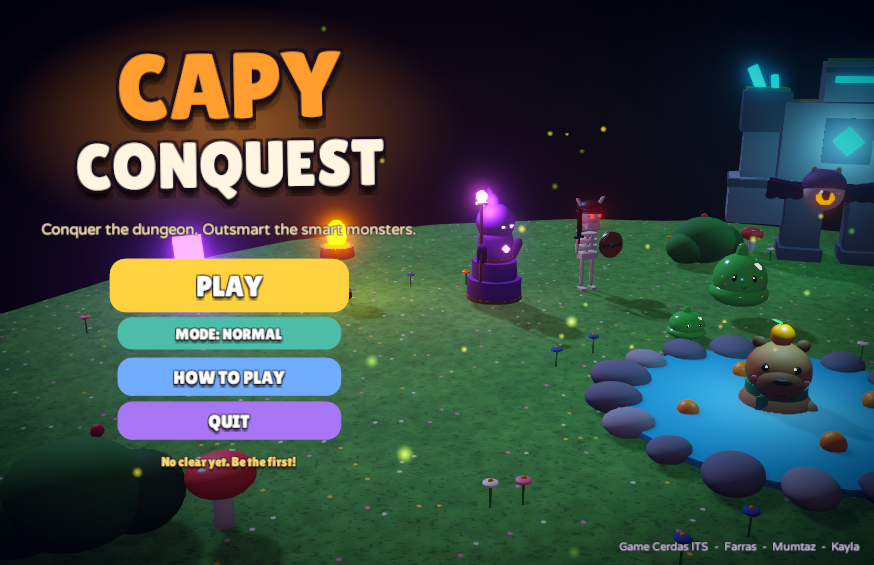
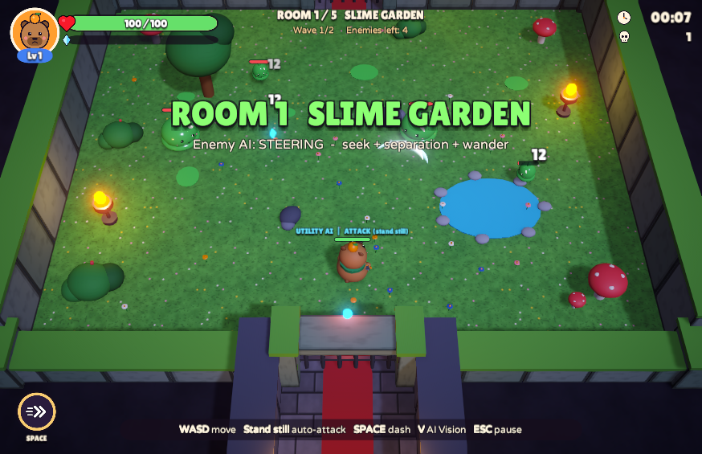
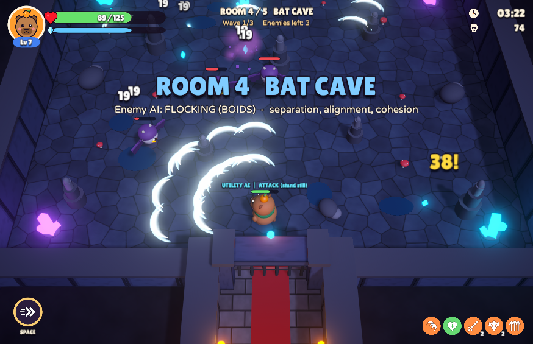
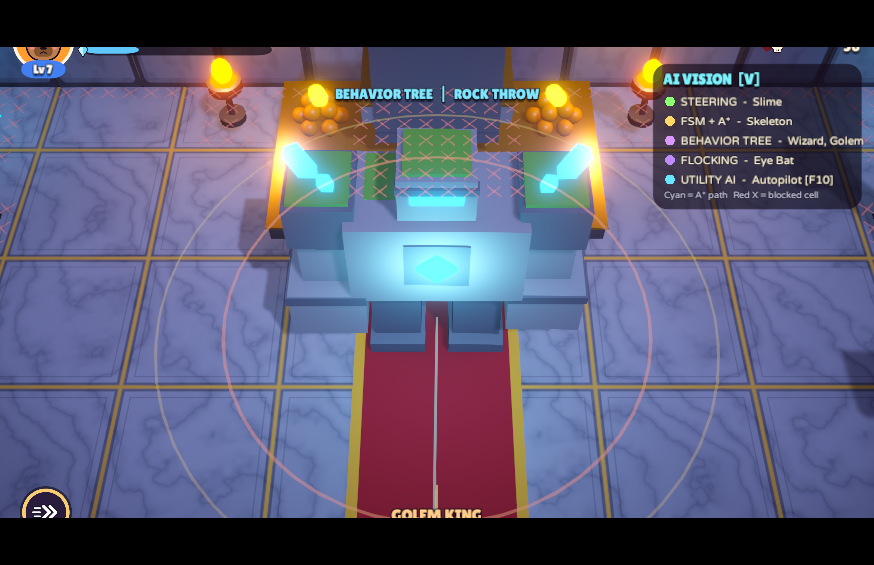
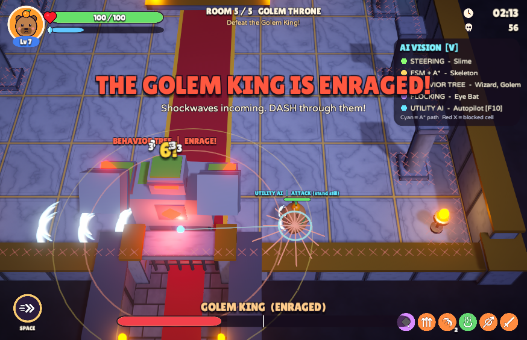
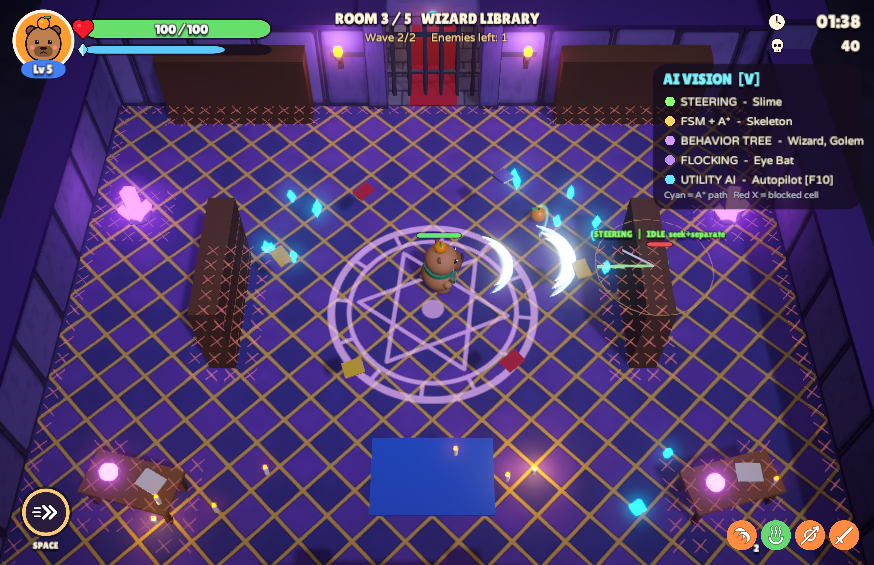

# Capy Conquest

Game aksi *roguelite* 3D untuk ETS Game Cerdas. Pemain mengendalikan **Capy**, capybara berpedang dengan jeruk di kepala, yang menaklukkan lima ruangan dungeon untuk merebut kembali **Golden Yuzu** dari **Golem King**. Setiap jenis musuh memakai teknik AI yang berbeda dari materi kuliah, dan semuanya bisa diperlihatkan langsung di dalam game lewat mode **AI Vision** (tombol `V`).



## Isi folder ini

| File | Isi |
|---|---|
| `CapyConquest_Windows.zip` | Game siap main untuk Windows. Ekstrak, lalu jalankan `CapyConquest.exe`. Tidak perlu Unity. |
| `CapyConquest_Project.zip` | Project Unity lengkap (Assets, Packages, ProjectSettings) untuk dibuka di Unity 6. |
| `Panduan_Presentasi_CapyConquest.md` | Naskah demo untuk Farras, Mumtaz, dan Kayla. |
| `img/` | Screenshot dari game (semua diambil dari Play Mode). |

Project kerjanya ada di `C:\Users\Mumtaza\GameCerdas_CapyConquest` (Unity 6000.6.0f1, URP).

> **Catatan versi:** kedua file zip dan semua screenshot di `img/` dibuat **sebelum** perubahan berikut: model karakter baru dari `CapyQuest_Assets`, serangan gaya HoloCure (bidik mouse, menyerang sambil berlari), dan penyeimbangan skill. Buat ulang build dengan menu **Capy Conquest → 3. Build Windows Player** sebelum dibagikan.

## Referensi game komersial

Game ini mengikuti rumus **Archero** (Habby, 2019), game mobile yang sangat laku. Habby juga pembuat **Capybara Go!** (2024), game bertema capybara yang sedang populer, jadi temanya nyambung. Ciri Archero yang dipakai:

- Ruangan demi ruangan. Pintu terkunci sampai semua musuh kalah, lalu pintu utara terbuka.
- **Naik level, pilih 1 dari 3 skill** yang muncul acak, sehingga setiap permainan berbeda.

Ditambah beberapa ciri dari game populer lain:

| Fitur | Diambil dari |
|---|---|
| **Serangan otomatis sambil berlari, arah dibidik dengan mouse**: selama ada musuh dalam jangkauan, Capy terus menebas sesuai kecepatan serang (30% lebih lambat saat berlari, penuh saat diam). Arah tebasan mengikuti kursor mouse (atau stik kanan gamepad), sehingga pemain bisa lari menghindar sambil menyerang ke arah lain. | HoloCure – Save the Fans! |
| Dash dengan kebal sesaat (i-frame), kartu judul boss | Hades |
| Pintu terkunci sampai ruangan bersih | The Binding of Isaac |
| Kristal XP yang tertarik ke pemain (magnet) | Vampire Survivors |
| Tanda bahaya merah di lantai sebelum serangan musuh | Hampir semua action game modern |

## Alur permainan

1. **Capy Camp** (aman): tempat belajar kontrol. Ada papan petunjuk ke utara.
2. **Ruang 1 Slime Garden**: slime melompat, slime besar membelah jadi dua.
3. **Ruang 2 Skeleton Barracks**: skeleton pedang dan pemanah. Hadiah: **peti harta** (satu skill gratis).
4. **Ruang 3 Wizard Library**: wizard yang teleport, memanggil slime, dan menembak orb sihir.
5. **Ruang 4 Bat Cave**: kawanan kelelawar mata. Hadiah: **onsen** (pemandian air panas, darah penuh).
6. **Ruang 5 Golem Throne**: boss **Golem King** dengan intro sinematik dan dua fase.
7. Ambil **Golden Yuzu** yang jatuh dari boss untuk menang. Layar kemenangan menampilkan waktu, rank (S/A/B/C), dan rekor waktu terbaik.

| | |
|---|---|
|  |  |
|  |  |

## Kontrol

| Tombol | Fungsi |
|---|---|
| `W A S D` / panah | Bergerak |
| Mouse / stik kanan | Membidik arah serangan otomatis (tanpa bidikan: ke musuh terdekat) |
| `Space` / `Shift` | Dash (kebal sesaat, bisa menembus shockwave dan panah) |
| `1` `2` `3` / klik mouse | Memilih kartu skill |
| `V` / `Tab` | AI Vision (melihat "isi kepala" AI) |
| `Esc` / `P` | Pause (Resume, Restart, Main Menu, musik/SFX on-off) |
| `F10` | Autopilot: AI yang memainkan Capy |
| Gamepad | Stik kiri bergerak, A dash, Start pause, Select AI Vision |

**Tombol darurat untuk presentasi** (tidak ditulis di dalam game):

| Tombol | Fungsi |
|---|---|
| `F1` | God mode (Capy tidak bisa terluka) |
| `F2` | Kalahkan semua musuh di ruangan |
| `F3` | Langsung naik level |
| `F4` | Lompat ke ruangan berikutnya |

## Teknik AI per musuh

| Musuh | Teknik AI | Cara kerja singkat | File kode |
|---|---|---|---|
| Slime | **Steering behavior** | Saat akan melompat, arah lompatan = Seek ke Capy + Separation dari slime lain + sedikit Wander (dijumlah dengan bobot). | `Scripts/Enemies/SlimeAI.cs`, `Scripts/AI/Steering.cs` |
| Skeleton | **Finite State Machine + A\*** | State Patrol, Chase, WindUp, Attack, Recover. Jika Capy terlihat ia jalan lurus; jika terhalang ia meminta jalur A\* dari grid ruangan. | `Scripts/Enemies/SkeletonAI.cs`, `Scripts/AI/Pathfinding/NavGrid.cs` |
| Skeleton Archer | **FSM + A\*** | Reposition, Aim (garis laser merah), Shoot, Cooldown, Retreat. Posisi tembak dipilih dengan memberi skor pada sel grid (jarak ideal + garis pandang). | `Scripts/Enemies/SkeletonArcherAI.cs` |
| Wizard | **Behavior Tree** | Selector berisi Sequence: sibuk? tunggu. Terlalu dekat? teleport. Pengikut kurang? summon slime. Capy terlihat? cast orb. Selain itu atur jarak. | `Scripts/Enemies/WizardAI.cs` |
| Eye Bat | **Flocking (Boids)** | Separation, Alignment, Cohesion dari tetangga dalam radius, ditambah target berputar di sekitar Capy dan batas ruangan. Sesekali satu kelelawar menukik. | `Scripts/Enemies/BatAI.cs` |
| Golem King | **Behavior Tree dua fase** | Di bawah 50% HP ia marah (fase 2): lebih cepat, hantaman menimbulkan shockwave, muncul hujan batu. Charge yang menabrak tembok membuatnya pusing dan menerima damage 1,5x. | `Scripts/Enemies/GolemBossAI.cs` |
| Autopilot (F10) | **Utility AI / context steering** | 16 arah gerak + pilihan "diam" diberi skor dari bahaya (musuh, proyektil, area merah, shockwave) dan tujuan (pintu, peti, onsen, Golden Yuzu). Pilihan dengan skor tertinggi dijalankan. | `Scripts/Player/AutoPilot.cs` |

Behavior Tree memakai framework dari Praktikum 06 (`BTNode`, `SelectorNode`, `SequenceNode`, `ConditionNode`, `ActionNode`, `CooldownDecorator`) tanpa diubah. Ditambah satu node baru, `CooldownGate`, karena `CooldownDecorator` milik modul mengembalikan `Running` selama cooldown. Akibatnya Selector berhenti di cabang itu dan cabang lain tidak pernah dicoba. `CooldownGate` mengembalikan `Failure` sehingga Selector lanjut ke cabang berikutnya.

### AI Vision (tombol V)



Saat aktif, game menampilkan:

- Label di atas setiap musuh: teknik AI dan state/aksi saat ini, misalnya `FSM | CHASE (A* path)` atau `BEHAVIOR TREE | TELEPORT`.
- Jalur A\* skeleton (garis biru muda) dan sel grid yang terblokir (tanda X merah).
- Vektor steering slime: hijau = Seek, oranye = Separation, biru = Wander.
- Garis tetangga kelelawar (flocking) dan arah tukikannya.
- Radius deteksi dan jarak serang, arah charge Golem.
- Skor 16 arah Autopilot (hijau = aman, merah = bahaya).

## Skill (17 jenis)

| Skill | Efek | Maks |
|---|---|---|
| Twin Slash | Setiap ayunan menembak satu gelombang lagi (50% damage) | 3 |
| Wide Swing | +1 gelombang sejajar (50% damage) | 2 |
| Diagonal Slash | +2 gelombang miring (50% damage) | 2 |
| Rear Guard | Juga menebas ke belakang (50% damage) | 1 |
| Piercing Edge | Gelombang menembus +1 musuh | 3 |
| Bouncy Blade | Gelombang memantul ke +1 musuh | 3 |
| Sharp Sword | Damage +25% dari damage dasar (dijumlah, maks +125%) | 5 |
| Zoomies | Kecepatan gerak +12% | 3 |
| Chill Vibes | Kecepatan serang +20% dari kecepatan dasar (dijumlah, maks +100%) | 5 |
| Thick Fur | Max HP +25 dan heal 25 | 5 |
| Yuzu Snack | Heal 40% (muncul jika HP di bawah 75%) | - |
| Yuzu Orbit | +1 jeruk yang berputar mengelilingi Capy | 3 |
| Spicy Yuzu | Serangan membakar musuh | 2 |
| Onsen Aura | Regenerasi 1,5 HP per detik | 2 |
| Lucky Leaf | Peluang kritikal +12% | 3 |
| Dash Master | Cooldown dash -30% dan dash melukai musuh | 2 |
| Munchies | Heal 3 HP setiap musuh kalah | 2 |

Penyeimbangan: dulu Sharp Sword dan Chill Vibes berlipat (1,25⁵ = 3,05x damage; 1,2⁵ = 2,49x kecepatan serang) dan semua gelombang tambahan damage penuh, sehingga damage ke satu musuh bisa mencapai sekitar 125x. Sekarang bonus keduanya dijumlah dari nilai dasar, gelombang tambahan hanya 50% damage, dan kecepatan serang turun 30% saat berlari. Perkiraan di atas kertas: maksimal sekitar 31x saat diam dan 22x saat berlari. Angka ini belum diuji di Play Mode. Pengalinya bisa diatur di komponen `PlayerCombat` (`movingAttackSpeed`, `extraWaveDamage`).

## Tingkat kesulitan

Tombol **MODE** di menu utama berganti antara EASY, NORMAL, dan HARD (tersimpan otomatis).

| Mode | HP musuh | Damage musuh |
|---|---|---|
| EASY | 0,7x | 0,6x |
| NORMAL | 1x | 1x |
| HARD | 1,4x | 1,3x |

Pengali ini dikalikan lagi dengan pengali per ruangan: HP 1x, 1,6x, 2x, 2,6x dan damage 1x, 1,1x, 1,2x, 1,3x untuk Ruang 1 sampai 4. HP Golem King 3000 (Normal).

## Hasil pengujian

Semua angka di bawah diukur di Play Mode dengan Autopilot sebagai pemain dan mode Normal (skrip `Assets/Editor/CapyAutoTest.cs`). Waktu adalah waktu game, jadi tidak terpengaruh pengali kecepatan uji.

> **Perlu diuji ulang:** uji A sampai F dilakukan pada versi lama, saat Capy hanya menyerang ketika diam dan skill masih berlipat. Sistem serangan dan skill sudah berubah (lihat bagian Skill), jadi durasi dan sisa HP di tabel ini tidak lagi mewakili versi sekarang.

| Uji | Versi | R1 | R2 | R3 | R4 | Boss | Total | Hasil |
|---|---|---|---|---|---|---|---|---|
| A | HP boss 1600 | 27,2 s | 47,7 s | 52,1 s | 29,5 s | 30,8 s | 3 m 28 s | Menang, damage diterima 126 |
| B | HP boss 1600 | 31,8 s | 32,0 s | 41,8 s | 25,4 s | 25,1 s | 2 m 58 s | Menang dengan sisa HP 5 |
| C | HP boss 2100 | 32,8 s | 37,9 s | 113,0 s | 31,2 s | 15,0 s | 4 m 12 s | Menang |
| D | + Wizard disesuaikan | 32,2 s | 50,5 s | 41,1 s | 25,5 s | 12,4 s | 3 m 04 s | Menang, damage diterima 83 |
| E | HP boss 3000 (versi akhir) | 30,7 s | 34,9 s | 65,8 s | 23,0 s | 25,1 s | 3 m 23 s | Menang, sisa HP 48 dari 100 |
| F | Versi akhir, Autopilot "mirip manusia" | 31,6 s | 31,2 s | 42,3 s | 28,4 s | 35,0 s | 3 m 09 s | Menang, sisa HP 20 dari 100 |

Uji F memakai mode `AutoPilot.HumanLike`: keputusan hanya setiap 0,3 detik (waktu reaksi), tanpa dash, dan proyektil baru diperhatikan dari jarak 4 unit. Hasilnya Ruang 1 sampai 3 tetap tanpa damage, Ruang 4 sedikit, dan hampir semua damage datang dari boss (80). Artinya kesulitan naik di akhir: ruangan awal berfungsi sebagai pemanasan dan boss menjadi tantangan utama.

Catatan:

- Sebelum penyeimbangan, Autopilot sampai di boss dalam sekitar 2 menit tanpa terluka. Karena itu HP dan damage musuh dinaikkan per ruangan, dan Ruang 2 sampai 4 diberi tiga gelombang.
- Uji C memperlihatkan Ruang 3 terlalu lama (113 detik) karena Wizard sering memanggil slime. Jeda summon dinaikkan dari 10 ke 13 detik dan HP Ruang 3 diturunkan dari 2,2x ke 2x. Pada uji D dan E Ruang 3 selesai dalam 41 dan 66 detik.
- Uji D memperlihatkan boss kalah dalam 12 detik saat build skill kuat, jadi HP boss dinaikkan ke 3000 (uji E: 25 detik).
- Skill yang ditawarkan acak, jadi durasi berbeda di setiap permainan.
- Autopilot jauh lebih jago menghindar daripada manusia (tidak pernah terluka di Ruang 1 dan 2 pada semua uji), jadi pemain manusia kemungkinan butuh waktu lebih lama dan lebih sering terluka. Ini belum diuji dengan pemain manusia; mode EASY tersedia jika terlalu sulit.
- Input keyboard diuji dengan event Input System: menekan `W` + `D` selama 1,5 detik menggerakkan Capy sejauh sekitar 6,8 unit, tombol `2` memilih kartu kedua, dan `Esc` membuka pause.
- Build Windows (`CapyConquest.exe`) dijalankan dan sampai di menu utama tanpa masalah (lihat `img/16_windows_build.png`).
- Suara diperiksa lewat kode: 38 klip punya durasi dan volume wajar (puncak 0,34 sampai 0,93). Di Play Mode, musik menu diputar looping dengan volume 0,42, berganti ke musik dungeon saat masuk game, dan efek suara langsung diputar saat dipicu. Yang belum bisa dipastikan hanya terdengar atau tidaknya di speaker, jadi coba sekali sebelum presentasi.

## Membuka project di Unity

1. Buka Unity Hub, pilih **Add > Add project from disk**, lalu pilih folder project (`GameCerdas_CapyConquest`, atau hasil ekstrak `CapyConquest_Project.zip`).
2. Gunakan Unity **6000.6.0f1** (Unity 6). Import pertama butuh beberapa menit.
3. Buka scene `Assets/Scenes/MainMenu.unity`, lalu tekan Play.

Tekstur, ikon, suara, prefab, dan kedua scene dibuat ulang dari kode lewat menu **Capy Conquest** di editor. Model karakter diambil dari file FBX di `Assets/Art/Models` (lihat bagian Model karakter):

| Menu | Fungsi |
|---|---|
| `1. Build All` | Membuat ulang seluruh tekstur, ikon, material, suara, musik, prefab, dan scene (sekitar 1 menit) |
| `2. Rebuild Prefabs + Scenes only` | Setelah mengubah angka musuh, tata letak ruangan, atau model karakter |
| `3. Build Windows Player` | Membuat `Build/CapyConquest/CapyConquest.exe` |

Perubahan di `Assets/Editor` (misalnya `CapyArt.cs`) baru terlihat setelah menu 2 dijalankan. Script game di `Assets/Scripts` langsung aktif tanpa rebuild. Jalankan menu saat tidak sedang Play Mode.

### Model karakter

Model karakter berasal dari asset pack tim `CapyQuest_Assets` (dibuat prosedural dengan Blender, lihat README di folder itu). File FBX-nya disalin ke `Assets/Art/Models` dan dimuat oleh `CapyArt.cs`:

| Di game | Model |
|---|---|
| Capy (player) | `Kapi.fbx` |
| Slime dan Slimelet | `Goo.fbx` (ukuran Slimelet 0,55x) |
| Skeleton | `BoneKnight.fbx` |
| Wizard | `HexMage.fbx` |
| Eye Bat | `Peeper.fbx` |
| Golem King | `CrystalGolem.fbx` |
| Skeleton Archer | Masih dari primitif Unity (tidak ada model pemanah) |

Cara pemuatan:

- Setting import FBX (skala 1, Bake Axis Conversion, material dari MaterialDescription) diterapkan otomatis oleh `Assets/Editor/CapyModelImport.cs`.
- Bagian model diberi nama yang dicari script animasi (misalnya `Leg_L` menjadi `LegL`, pedang Kapi menjadi `SwordPivot`) dan dijadikan anak langsung `Body`.
- Setiap bagian dibungkus pivot tanpa rotasi, dan mesh di dalamnya diputar 180°. Ada dua alasan. Pertama, FBX dari Blender menghadap -Z di Unity, sedangkan game menganggap depan = +Z. Kedua, script animasi menimpa rotasi kaki, lengan, dan sayap secara absolut, sehingga rotasi bawaan FBX harus disimpan di mesh, bukan di pivot.
- Model diskalakan ke tinggi model primitif lama (Capy 1,95 m, Skeleton 2,1 m, Wizard 2,4 m, Golem 5 m), supaya collider dan health bar tetap pas.
- Material `Glow_*` diganti material glow project agar terkena Bloom. Kristal Golem berganti warna per fase lewat `EnemyBase.ReplaceMaterial`, yang hanya mengganti slot kristal.

### Struktur kode

```
Assets/Scripts
  AI/            Steering, NavGrid (A*), AIDebugDraw (AI Vision), BehaviorTree (modul P06 + CooldownGate)
  Combat/        Projectile, LobProjectile (batu), Telegraph (tanda bahaya), Shockwave, OrbitYuzu
  Core/          GameManager, CameraRig, AudioManager, VFX, CapyInput, GameDatabase
  Enemies/       EnemyBase, SlimeAI, SkeletonAI, SkeletonArcherAI, WizardAI, BatAI, GolemBossAI
  Level/         RoomController, Door, XPGem, YuzuPickup, TreasureChest, HotSpring, GoldenYuzu, dekorasi
  Player/        PlayerController, PlayerHealth, PlayerCombat, PlayerVisual, PlayerStats, AutoPilot
  UI/            GameUI (HUD dan panel), WorldUI (angka damage, bar, label AI), MainMenuController
  Upgrades/      UpgradeLibrary (17 skill)
Assets/Editor    Builder aset, prefab, scene, uji otomatis, setting import FBX (CapyModelImport)
Assets/Art/Models  Model karakter FBX dari CapyQuest_Assets
```

## Kredit

- Kelompok: Farras, Mumtaz, Kayla. Mata kuliah Game Cerdas, Teknik Informatika ITS.
- Font: **Lilita One** dan **Varela Round** dari Google Fonts, lisensi SIL Open Font License (file lisensi ada di `Assets/Fonts`).
- Model karakter dari asset pack tim `CapyQuest_Assets`. Menurut README asset pack itu, modelnya dibuat prosedural dengan Blender oleh tim, dibantu AI.
- Model properti level, tekstur, ikon, efek, suara, dan musik dibuat secara prosedural di dalam project, tanpa aset pihak ketiga.
- Desain karakter mengikuti gambar konsep di folder `ETS`.
